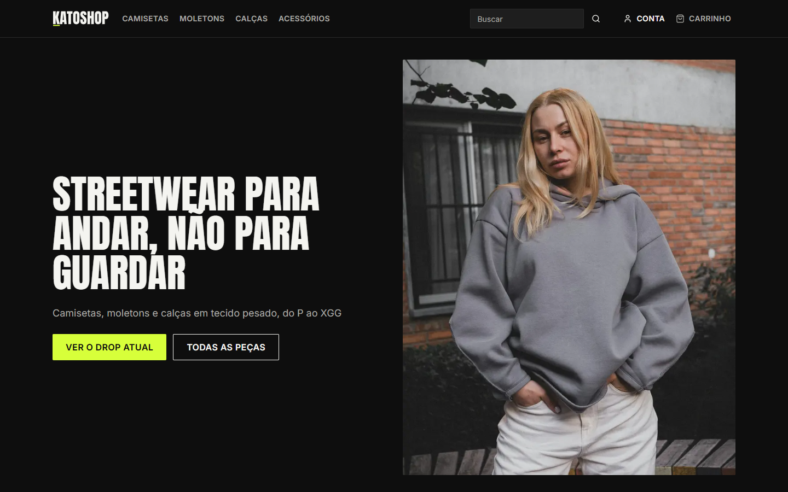
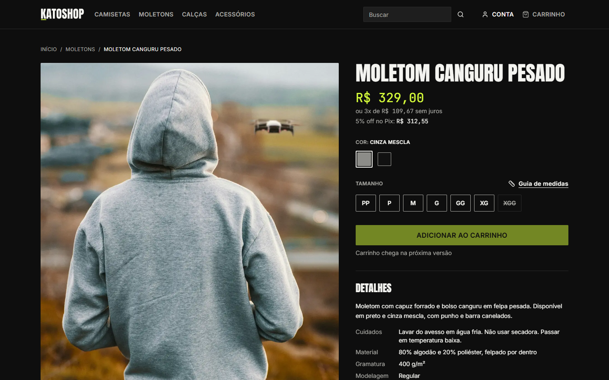

# KatoShop

KatoShop é um template de e-commerce em microsserviços, apresentado com uma loja demo de streetwear. O objetivo é servir
de portfólio de arquitetura: serviços independentes com um banco Postgres cada, gateway Traefik, loja e painel de
administração em Next.js, autenticação com JWT validado por cada serviço e rastreamento ponta a ponta no Jaeger. Tudo
roda localmente com Docker Compose, sem conta em nenhum serviço externo. A loja é demonstrativa: nenhuma compra é real.





## Status

Fatia 1 de 5 concluída: fundação, serviço de identidade, serviço de catálogo, loja navegável, admin de catálogo e
observabilidade. O carrinho, os cupons, o checkout com saga e o restante do painel vêm nas próximas fatias (ver
[Roadmap](#roadmap)).

O que existe hoje:

- Loja com home, coleções, categorias, busca em português, filtros combinados (tamanho, cor, faixa de preço e
  categoria), página de produto com fotos por cor e tamanho esgotado conforme o estoque real, cadastro, login, logout e
  área da conta.
- Admin com login de funcionário, criação de produto, grade de variantes (cores por tamanhos), ajuste de estoque com
  motivo, upload de fotos e publicação. O produto publicado aparece na loja em até 60 s.
- Traces de uma requisição da loja no Jaeger, com spans do Next, do Traefik, do catalog e do Postgres.

## Pré-requisitos

- Docker Desktop (Compose v2).
- Node.js 26 LTS e pnpm 12.18.0. O pnpm vem pelo campo `packageManager` do `package.json` (com Corepack ativado, ou
  instale a versão indicada).
- uv. O Python 3.15.2 é baixado e gerenciado pelo uv.
- As portas 80, 8081, 16686 e 3001 livres no host. Para mudar a porta 80, altere `KATOSHOP_HTTP_PORT` no `.env`.
- Navegadores modernos resolvem `*.localhost` para a máquina local sem configuração.

## Como rodar

```bash
pnpm install && pnpm dev:up && pnpm seed
```

- `pnpm dev:up` gera a chave de assinatura do identity em `infra/secrets/`, cria o `.env` a partir do `.env.example` (se
  ele ainda não existir) e sobe o núcleo do Compose: Postgres, identity, catalog, Traefik, loja e admin.
- `pnpm seed` publica a loja demo (24 produtos com fotos reais creditadas). Pode ser repetido sem duplicar dados.
- `pnpm dev:down` derruba tudo e mantém os volumes. Para apagar também os dados locais, use
  `docker compose --profile "*" down -v`.

Observabilidade (Jaeger, Prometheus, Grafana) fica em um perfil à parte e não sobe com o `dev:up`:

```bash
docker compose --profile observability up -d
```

### URLs

| O quê | Endereço |
|---|---|
| Loja | http://katoshop.localhost |
| Admin | http://admin.katoshop.localhost |
| API (gateway) | http://api.katoshop.localhost (`/identity/v1/...`, `/catalog/v1/...`) |
| Dashboard do Traefik | http://localhost:8081 |
| Jaeger (perfil `observability`) | http://localhost:16686 |
| Grafana (perfil `observability`) | http://localhost:3001 |

### Credencial demo do admin

Conta de demonstração criada pelo identity na primeira subida (valores do `.env.example`, só para uso local):

- email: `admin@katoshop.localhost`
- senha: `katoshop-demo-2026`

Não use essa credencial fora do ambiente local.

## Testes

Cada pacote Python roda separadamente, porque cada `conftest.py` registra os plugins de teste da lib compartilhada.
Os testes de integração usam testcontainers (`postgres:18.6-alpine`), então o Docker precisa estar rodando.

```bash
uv sync --all-packages --all-groups
uv run pytest libs/py/platform -q
uv run pytest services/identity -q
uv run pytest services/catalog -q
uv run pytest scripts/seed -q
uv run ruff check . && uv run ruff format --check .
uv run pyright services/identity services/catalog libs
```

No Windows com bloqueio de executáveis (App Control), use `uv run python -m pytest ...` e
`uv run python -m pyright ...`.

Frontend (lint, typecheck e testes unitários de todos os pacotes):

```bash
pnpm lint
pnpm typecheck
pnpm test
```

Ponta a ponta (Playwright) e Lighthouse, contra a pilha no ar e com o seed aplicado:

```bash
pnpm --filter e2e exec playwright install chromium   # uma vez
pnpm test:e2e
pnpm --filter e2e lhci
```

Se o Chromium baixado pelo Playwright for bloqueado, use o Chrome instalado: `E2E_BROWSER_CHANNEL=chrome pnpm test:e2e`.
O Lighthouse da home e da página de produto (desktop) exige Acessibilidade 95 ou mais e Performance 90 ou mais.

O contrato OpenAPI é versionado em `packages/api-client/openapi/`. Depois de mudar uma API, rode `pnpm gen:api` e
inclua a diferença no commit; a CI falha se o contrato gerado divergir do versionado.

## Mapa de pastas

```
services/identity/       identity: clientes, funcionários, login, tokens, JWKS
services/catalog/        catalog: produtos, variantes, estoque, coleções, imagens, busca, vitrine
libs/py/platform/        ks_platform: observabilidade, verificação de JWT, problem+json, helpers de teste
apps/storefront/         loja (Next.js), katoshop.localhost
apps/admin/              painel (Next.js), admin.katoshop.localhost
packages/ui/             design system: tokens, componentes, ícones, logo
packages/api-client/     cliente TypeScript gerado do OpenAPI e sessão por cookies httpOnly
packages/config/         tsconfig, eslint e prettier compartilhados
infra/                   compose, Traefik, init do Postgres, Collector, Prometheus, Grafana
scripts/                 geração de chaves, export do OpenAPI e seed da loja demo (scripts/seed)
e2e/                     testes ponta a ponta (Playwright) e Lighthouse
docs/                    arquitetura, ADRs, specs e planos
```

## Documentação

- [Arquitetura](docs/architecture.md): diagrama, responsabilidades, regras de comunicação, eventos previstos e limites
  de taxa do gateway.
- ADRs (decisões de arquitetura):
  - [0001 Microsserviços com um banco por serviço](docs/adr/0001-microsservicos-banco-por-servico.md)
  - [0002 Saga orquestrada em vez de coreografia](docs/adr/0002-saga-orquestrada.md)
  - [0003 RabbitMQ como broker](docs/adr/0003-rabbitmq.md)
  - [0004 Estoque dentro do catalog](docs/adr/0004-estoque-no-catalog.md)
  - [0005 BFF com cookies httpOnly](docs/adr/0005-bff-cookies-httponly.md)
  - [0006 Cada serviço valida o JWT](docs/adr/0006-validacao-jwt-por-servico.md)
  - [0007 TypeScript 6.0.3 no workspace](docs/adr/0007-typescript-6.md)
- [Spec de design geral e fatia 1](docs/superpowers/specs/2026-10-23-katoshop-design.md) e
  [plano da fatia 1](docs/superpowers/plans/2026-10-23-katoshop-fatia-1.md).

## Roadmap

| Fatia | Conteúdo |
|---|---|
| 1 | Fundação, identity, catalog, loja navegável, admin de catálogo, observabilidade (concluída) |
| 2 | RabbitMQ com outbox, cart (Redis), promotions (motor de regras de cupom), carrinho na loja, cupons no admin |
| 3 | orders com saga, payments (fake e Mercado Pago sandbox), shipping (fake e Melhor Envio sandbox), checkout completo |
| 4 | Admin completo: KPIs, RBAC, auditoria, saúde do sistema (filas, DLQ, reprocesso), edição da vitrine, pedidos |
| 5 | Dashboards Grafana finais, teste de carga (k6), GIFs e vídeo de apresentação |

## Limitações conhecidas

- Os acessórios (gorros, bonés) não têm tamanho único: o seed usa o tamanho M como "único". Um tamanho "Único" fica
  para uma migração futura.
- O job `ci-e2e` (pilha completa, Playwright e Lighthouse) foi escrito, mas ainda não rodou no GitHub Actions. Os mesmos
  testes passam localmente.
- Não há RabbitMQ, Redis, carrinho nem checkout nesta fatia. Os serviços cart, promotions, orders, payments e shipping
  ainda não existem.
- As fotos ficam em um volume de disco local do catalog, sem object store.
- `PUT /v1/admin/storefront/settings` só é usado pelo seed. A edição da vitrine pelo admin chega na fatia 4.
- Não há rotação automática da chave de assinatura nem revogação imediata de access tokens (valem até 15 minutos).
- O init do Postgres roda só em volume novo: mudar senhas de banco no `.env` depois da primeira subida exige recriar o
  volume.
- Windows: o Windows App Control pode bloquear executáveis do `.venv` (use `uv run python -m ...`) e o Chromium do
  Playwright (use `E2E_BROWSER_CHANNEL=chrome`). Mantenha o repositório com finais de linha LF (o `.gitattributes` já
  cuida disso), pois scripts copiados para containers Linux quebram com CRLF.
- Os textos de privacidade e de termos da loja são modelos de demonstração, não aconselhamento jurídico.

## Licença e créditos

Código sob licença [MIT](LICENSE).

As fotos de produto são reais, de bancos com licença livre, e não foram geradas por IA. O autor, a origem e a licença
de cada foto estão na página `/creditos` da loja (http://katoshop.localhost/creditos) e no manifesto
[`scripts/seed/images.json`](scripts/seed/images.json). As fotos vêm do Unsplash e seguem a
[Unsplash License](https://unsplash.com/license).
