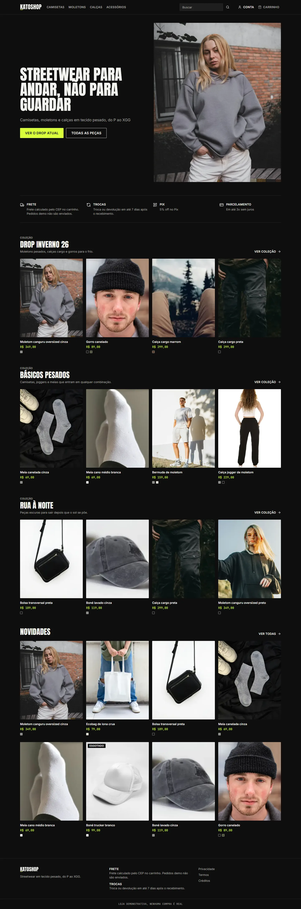
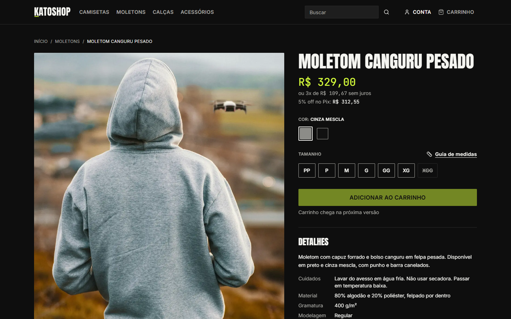
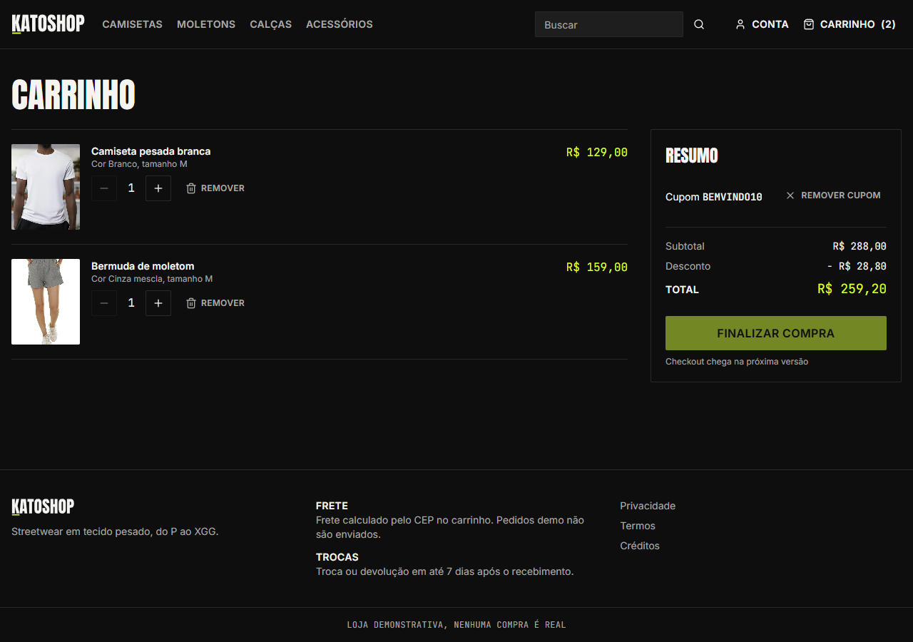

# KatoShop

KatoShop é um template de e-commerce em microsserviços, apresentado com uma loja demo de streetwear. O objetivo é servir
de portfólio de arquitetura: serviços independentes com um banco Postgres cada, gateway Traefik, loja e painel de
administração em Next.js, autenticação com JWT validado por cada serviço e rastreamento ponta a ponta no Jaeger. Tudo
roda localmente com Docker Compose, sem conta em nenhum serviço externo. A loja é demonstrativa: nenhuma compra é real.







## Status

Fatia 2 de 5 concluída. A fatia 1 entregou a fundação, o serviço de identidade, o serviço de catálogo, a loja
navegável, o admin de catálogo e a observabilidade. A fatia 2 entregou a mensageria (RabbitMQ com outbox), o carrinho
(serviço cart, no Redis), o motor de cupons (serviço promotions), o carrinho na loja e a gestão de cupons no admin. O
checkout com saga e o restante do painel vêm nas próximas fatias (ver [Roadmap](#roadmap)).

O que existe hoje:

- Loja com home, coleções, categorias, busca em português, filtros combinados (tamanho, cor, faixa de preço e
  categoria), página de produto com fotos por cor e tamanho esgotado conforme o estoque real, cadastro, login, logout e
  área da conta.
- Carrinho de visitante (sem login) e de cliente, com cabeçalho "Carrinho (N)", página `/carrinho` com quantidade,
  remover, "Limpar indisponíveis", cupom e resumo. Ao entrar na conta, o carrinho do visitante é unido ao da conta,
  somando o mesmo SKU até o limite do estoque. O carrinho do visitante dura 30 dias; o do cliente não expira.
- O carrinho reage ao catálogo por eventos: preço alterado no admin aparece no carrinho com o aviso "preço mudou de
  R$ X para R$ Y", estoque zerado ou produto arquivado deixa o item indisponível, e estoque abaixo da quantidade reduz
  a quantidade com aviso. Os avisos usam só dados reais.
- Cupons de percentual e de valor fixo, com pedido mínimo, validade, limites de uso e restrição a categorias ou
  coleções. O motivo de um cupom recusado aparece em português. O checkout (botão "Finalizar compra") chega na fatia 3.
- Admin com login de funcionário, criação de produto, grade de variantes (cores por tamanhos), ajuste de estoque com
  motivo, upload de fotos, publicação e gestão de cupons (criar, editar com conflito de versão, ativar, desativar e
  excluir sem usos). O produto publicado aparece na loja em até 60 s.
- Traces no Jaeger, com spans do Next, do Traefik, dos serviços e do Postgres. Um evento do catálogo aparece no mesmo
  trace da requisição do admin que o gerou, passando pelo RabbitMQ até o cart.

## Pré-requisitos

- Docker Desktop (Compose v2).
- Node.js 26 LTS e pnpm 12.18.0. O pnpm vem pelo campo `packageManager` do `package.json` (com Corepack ativado, ou
  instale a versão indicada).
- uv. O Python 3.15.2 é baixado e gerenciado pelo uv.
- As portas 80, 8081, 15672, 16686 e 3001 livres no host. Para mudar a porta 80, altere `KATOSHOP_HTTP_PORT` no `.env`.
- Navegadores modernos resolvem `*.localhost` para a máquina local sem configuração.

## Como rodar

```bash
pnpm install && pnpm dev:up && pnpm seed
```

- `pnpm dev:up` gera a chave de assinatura do identity em `infra/secrets/`, cria o `.env` a partir do `.env.example` (se
  ele ainda não existir) e sobe o núcleo do Compose: Postgres, RabbitMQ, Redis, identity, catalog, cart, promotions,
  Traefik, loja e admin.
- `pnpm seed` publica a loja demo (24 produtos com fotos reais creditadas). Pode ser repetido sem duplicar dados.
- `pnpm dev:down` derruba tudo e mantém os volumes. Para apagar também os dados locais, use
  `docker compose --profile "*" down -v`.

### Atualizar um ambiente da fatia 1

Ambiente criado antes da fatia 2 (volume do Postgres e `.env` já existentes): o `dev:up` não sobrescreve o `.env`, então
copie do `.env.example` as chaves novas:

- `PROMOTIONS_DB_PASSWORD`;
- `RABBITMQ_USER`, `RABBITMQ_PASSWORD`, `CATALOG_AMQP_URL` e `CART_AMQP_URL`;
- `CART_REDIS_URL`, `CART_CATALOG_URL`, `CART_PROMOTIONS_URL` e `CART_IDENTITY_TOKEN_URL`;
- `IDENTITY_SERVICE_CLIENTS` e `CART_CLIENT_SECRET` (o mesmo segredo nas duas).

Depois crie o banco do promotions sem apagar nada (o init do Postgres só roda em volume novo) e suba a pilha:

```bash
docker compose up -d postgres
docker compose exec postgres sh /docker-entrypoint-initdb.d/01-databases.sh
pnpm dev:up && pnpm seed
```

O `pnpm seed` cria o cupom demo. No Docker Desktop do Windows, o Traefik não percebe mudança em
`infra/traefik/dynamic.yml` (o `watch` do provider de arquivo não dispara no volume montado). Depois de atualizar o
repositório ou de editar o arquivo, reinicie o gateway:

```bash
docker compose restart traefik
```

Observabilidade (Jaeger, Prometheus, Grafana) fica em um perfil à parte e não sobe com o `dev:up`:

```bash
docker compose --profile observability up -d
```

### URLs

| O quê | Endereço |
|---|---|
| Loja | http://katoshop.localhost |
| Admin | http://admin.katoshop.localhost |
| API (gateway) | http://api.katoshop.localhost (`/identity/v1/...`, `/catalog/v1/...`, `/cart/v1/...`, `/promotions/v1/admin/...`) |
| Dashboard do Traefik | http://localhost:8081 |
| RabbitMQ (UI de gestão) | http://127.0.0.1:15672 (usuário e senha `RABBITMQ_USER`/`RABBITMQ_PASSWORD` do `.env`) |
| Jaeger (perfil `observability`) | http://localhost:16686 |
| Grafana (perfil `observability`) | http://localhost:3001 |

### Credencial demo do admin

Conta de demonstração criada pelo identity na primeira subida (valores do `.env.example`, só para uso local):

- email: `admin@katoshop.localhost`
- senha: `katoshop-demo-2026`

Não use essa credencial fora do ambiente local.

### Cupom demo

O `pnpm seed` cria o cupom de demonstração `BEMVINDO10`: 10% de desconto em pedidos a partir de R$ 150,00, sem
data de fim nem limite de usos. É um dado de demonstração da loja local, não uma oferta real (nenhuma compra é real). Os
cupons `E2E-*` são criados pelos testes ponta a ponta.

As filas e os eventos podem ser acompanhados na UI do RabbitMQ (fila `cart.catalog-events`, filas de retry e DLQ) e,
no perfil `observability`, no dashboard "KatoShop mensageria" do Grafana.

## Testes

Cada pacote Python roda separadamente, porque cada `conftest.py` registra os plugins de teste da lib compartilhada.
Os testes de integração usam testcontainers (Postgres, RabbitMQ e Redis reais), então o Docker precisa estar rodando.

```bash
uv sync --all-packages --all-groups
uv run pytest libs/py/platform -q
uv run pytest services/identity -q
uv run pytest services/catalog -q
uv run pytest services/cart -q
uv run pytest services/promotions -q
uv run pytest scripts/seed -q
uv run ruff check . && uv run ruff format --check .
uv run pyright services/identity services/catalog services/cart services/promotions libs
```

No Windows com bloqueio de executáveis (App Control), use `uv run python -m pytest ...` e
`uv run python -m pyright ...`. Se o Smart App Control bloquear também as extensões nativas do `.venv`, rode as mesmas
ferramentas num container Linux: `scripts/test-in-docker.sh python -m pytest services/cart -q`.

Frontend (lint, typecheck e testes unitários de todos os pacotes):

```bash
pnpm lint
pnpm typecheck
pnpm test
```

Ponta a ponta (Playwright) e Lighthouse, contra a pilha no ar e com o seed aplicado:

```bash
pnpm --filter e2e exec playwright install chromium   # uma vez
pnpm test:e2e
pnpm --filter e2e lhci
```

Se o Chromium baixado pelo Playwright for bloqueado, use o Chrome instalado: `E2E_BROWSER_CHANNEL=chrome pnpm test:e2e`.
O Lighthouse da home e da página de produto (desktop) exige Acessibilidade 95 ou mais e Performance 90 ou mais.

O contrato OpenAPI é versionado em `packages/api-client/openapi/`. Depois de mudar uma API, rode `pnpm gen:api` e
inclua a diferença no commit; a CI falha se o contrato gerado divergir do versionado.

## Mapa de pastas

```
services/identity/       identity: clientes, funcionários, login, tokens, JWKS
services/catalog/        catalog: produtos, variantes, estoque, coleções, imagens, busca, vitrine, outbox de eventos
services/cart/           cart: carrinho no Redis, merge no login, consumidor dos eventos do catalog
services/promotions/     promotions: cupons, regras e cálculo do desconto
libs/py/platform/        ks_platform: observabilidade, JWT e token de serviço, problem+json, outbox, mensageria, testes
apps/storefront/         loja (Next.js), katoshop.localhost
apps/admin/              painel (Next.js), admin.katoshop.localhost
packages/ui/             design system: tokens, componentes, ícones, logo
packages/api-client/     cliente TypeScript gerado do OpenAPI e sessão por cookies httpOnly
packages/config/         tsconfig, eslint e prettier compartilhados
infra/                   compose, Traefik, init do Postgres, Collector, Prometheus, Grafana
scripts/                 geração de chaves, export do OpenAPI e seed da loja demo (scripts/seed)
e2e/                     testes ponta a ponta (Playwright) e Lighthouse
docs/                    arquitetura, ADRs, specs e planos
```

## Documentação

- [Arquitetura](docs/architecture.md): diagrama, responsabilidades, regras de comunicação, eventos e filas, fluxos do
  carrinho e do cupom e limites de taxa do gateway.
- ADRs (decisões de arquitetura):
  - [0001 Microsserviços com um banco por serviço](docs/adr/0001-microsservicos-banco-por-servico.md)
  - [0002 Saga orquestrada em vez de coreografia](docs/adr/0002-saga-orquestrada.md)
  - [0003 RabbitMQ como broker](docs/adr/0003-rabbitmq.md)
  - [0004 Estoque dentro do catalog](docs/adr/0004-estoque-no-catalog.md)
  - [0005 BFF com cookies httpOnly](docs/adr/0005-bff-cookies-httponly.md)
  - [0006 Cada serviço valida o JWT](docs/adr/0006-validacao-jwt-por-servico.md)
  - [0007 TypeScript 6.0.3 no workspace](docs/adr/0007-typescript-6.md)
  - [0008 Outbox transacional e consumo idempotente de eventos](docs/adr/0008-outbox-e-mensageria.md)
  - [0009 Token de serviço por client credentials](docs/adr/0009-token-de-servico.md)
- [Spec de design geral e fatia 1](docs/superpowers/specs/2026-10-23-katoshop-design.md) e
  [plano da fatia 1](docs/superpowers/plans/2026-10-23-katoshop-fatia-1.md).
- [Spec da fatia 2](docs/superpowers/specs/2026-11-13-katoshop-fatia-2-design.md) e
  [plano da fatia 2](docs/superpowers/plans/2026-11-13-katoshop-fatia-2.md).

## Roadmap

| Fatia | Conteúdo |
|---|---|
| 1 | Fundação, identity, catalog, loja navegável, admin de catálogo, observabilidade (concluída) |
| 2 | RabbitMQ com outbox, cart (Redis), promotions (motor de regras de cupom), carrinho na loja, cupons no admin (concluída) |
| 3 | orders com saga, payments (fake e Mercado Pago sandbox), shipping (fake e Melhor Envio sandbox), checkout completo |
| 4 | Admin completo: KPIs, RBAC, auditoria, saúde do sistema (filas, DLQ, reprocesso), edição da vitrine, pedidos |
| 5 | Dashboards Grafana finais, teste de carga (k6), GIFs e vídeo de apresentação |

## Limitações conhecidas

- Os acessórios (gorros, bonés) não têm tamanho único: o seed usa o tamanho M como "único". Um tamanho "Único" fica
  para uma migração futura.
- O teste e2e `admin-to-store` falhou uma vez logo depois de subir o perfil de observabilidade e rodar o seed, e não
  voltou a falhar em 5 execuções seguidas (3 depois de `pnpm seed`, 2 depois de reiniciar loja e admin). A causa não foi
  identificada; a suspeita é carga da máquina durante a subida dos containers. O teste espera até 70 s pelo cache de 60 s
  da loja. Se acontecer, rode de novo.
- A busca usa AND entre os termos em nome, categoria e descrição (`websearch_to_tsquery`). "moletom preto" acha o moletom
  preto primeiro, mas também peças cuja descrição cita os dois termos, como a calça jogger de moletom.
- Não há checkout nem resgate de cupom: o "Finalizar compra" fica desabilitado, e a contagem de usos do cupom começa na
  fatia 3. Os serviços orders, payments e shipping ainda não existem. Frete grátis, promoções automáticas (sem código),
  cupons cumulativos e a tela de DLQ com reprocessamento no admin ficam para as fatias 3 e 4.
- O id do carrinho de visitante (cookie `ks_cart`, httpOnly, `SameSite=Lax`) funciona como um segredo do portador:
  quem conhece o id consegue ler o carrinho e, logado, juntá-lo à própria conta no merge. O id é um UUIDv4 aleatório e
  nunca aparece na página; o risco é aceito para a demo. Um id de carrinho de cliente enviado como visitante é tratado
  como inexistente.
- Com o promotions fora do ar, o carrinho continua funcionando sem desconto e mostra "Não foi possível validar o cupom
  agora."; aplicar um cupom novo nesse estado responde 503 e não grava nada.
- Eventos publicados antes de o cart declarar a fila `cart.catalog-events` (primeira subida com o cart parado) se
  perdem, porque o exchange não tem fila ligada. O compose sobe o cart junto com o broker, e um item adicionado depois
  lê o preço atual ([ADR 0008](docs/adr/0008-outbox-e-mensageria.md)).
- O arquivamento de produto não tem versão. Uma reentrega depois de um processamento parcial pode fazer reaparecer um
  aviso de item arquivado que o cliente já tinha confirmado com "Entendi"
  ([ADR 0008](docs/adr/0008-outbox-e-mensageria.md)).
- A lista de cupons do admin depende do catalog para mostrar os nomes de categorias e coleções; com o catalog fora do
  ar, a lista falha.
- Cada execução do e2e ajusta estoque de variantes do seed e devolve os valores ao fim, mas o histórico de movimentos
  de estoque cresce a cada execução (os registros ficam no banco, R26). Produtos e cupons criados pelos testes são
  arquivados ou desativados por `pnpm seed:archive-test-data`.
- A troca de senha em `PATCH /identity/v1/me` confere a senha atual sem limite de taxa próprio (vem da fatia 1). Está
  no backlog.
- O Traefik não recarrega o `dynamic.yml` sozinho no Docker Desktop do Windows; depois de mudar o arquivo, rode
  `docker compose restart traefik`.
- As fotos ficam em um volume de disco local do catalog, sem object store.
- `PUT /v1/admin/storefront/settings` só é usado pelo seed. A edição da vitrine pelo admin chega na fatia 4.
- Login e cadastro feitos pela loja e pelo admin chegam ao identity pelo IP do container do Next, então dividem um
  balde de limite de taxa no gateway. Um único cliente abusivo pode esgotar esse balde e bloquear o login de todos com
  429 enquanto durar o abuso. Aceito para a demo local; a correção prevista é o BFF repassar um IP de cliente confiável
  e o identity limitar por cliente ([arquitetura](docs/architecture.md#gateway-e-limites-de-taxa),
  [ADR 0005](docs/adr/0005-bff-cookies-httponly.md)).
- Não há rotação automática da chave de assinatura nem revogação imediata de access tokens (valem até 15 minutos).
- O init do Postgres roda só em volume novo: mudar senhas de banco no `.env` depois da primeira subida exige recriar o
  volume.
- Windows: o Windows App Control pode bloquear executáveis do `.venv` (use `uv run python -m ...`) e o Chromium do
  Playwright (use `E2E_BROWSER_CHANNEL=chrome`). Mantenha o repositório com finais de linha LF (o `.gitattributes` já
  cuida disso), pois scripts copiados para containers Linux quebram com CRLF.
- Os textos de privacidade e de termos da loja são modelos de demonstração, não aconselhamento jurídico.
- Desvios da spec registrados nesta fatia (R29): os formulários validam no servidor (Server Actions e a API), sem zod
  (spec §4.4); o painel de saúde do Postgres no Grafana fica para a fatia 5 (spec §4.6).

## Licença e créditos

Código sob licença [MIT](LICENSE).

As fotos de produto são reais, de bancos com licença livre, e não foram geradas por IA. O autor, a origem e a licença
de cada foto estão na página `/creditos` da loja (http://katoshop.localhost/creditos) e no manifesto
[`scripts/seed/images.json`](scripts/seed/images.json). As fotos vêm do Unsplash e seguem a
[Unsplash License](https://unsplash.com/license).
